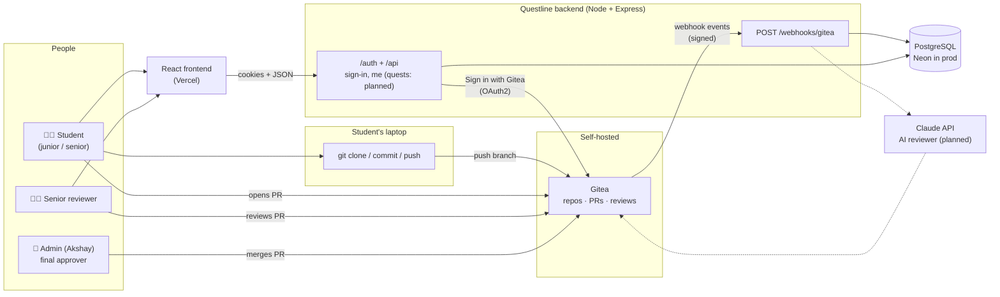
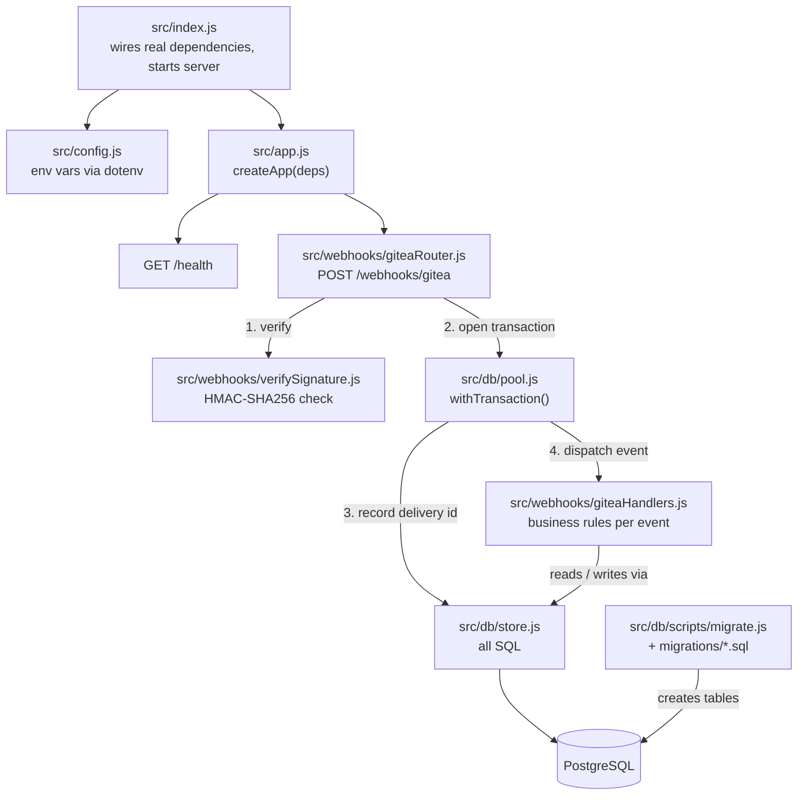
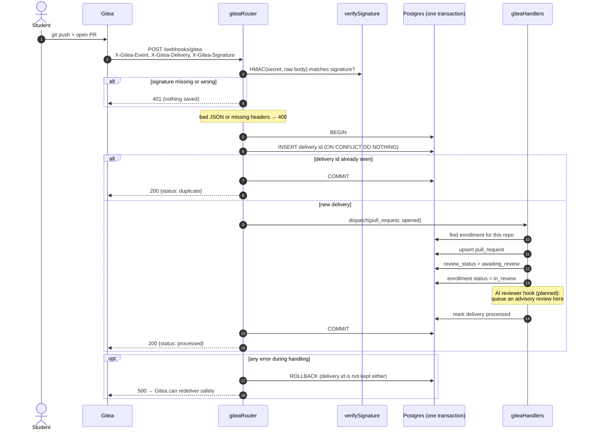
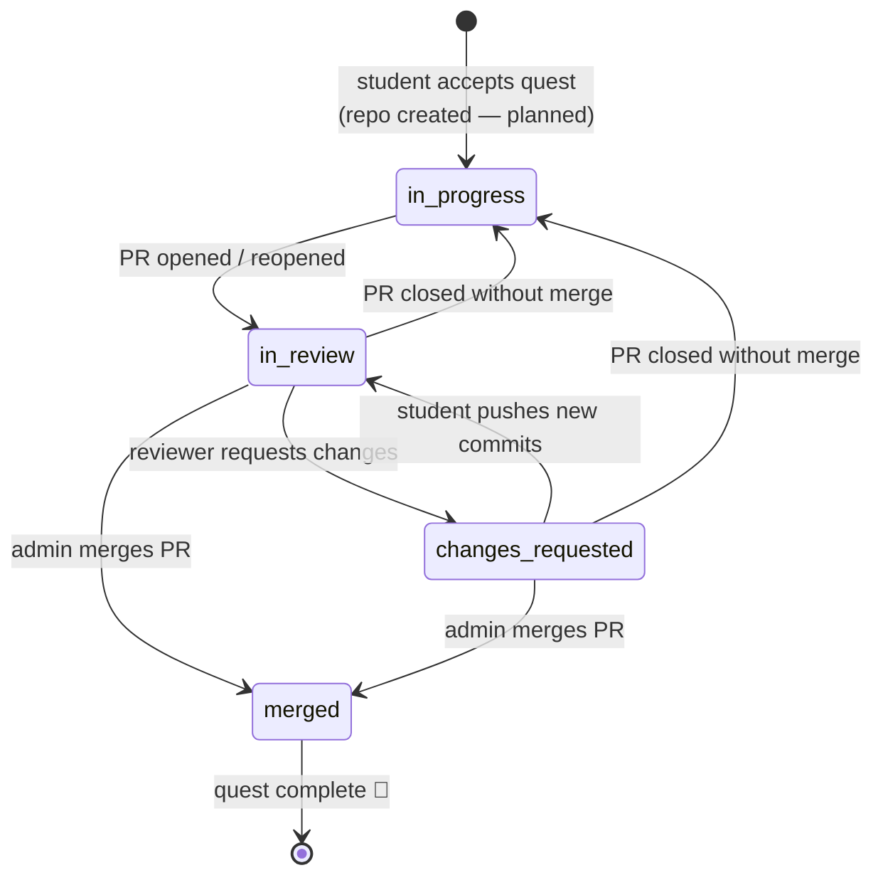
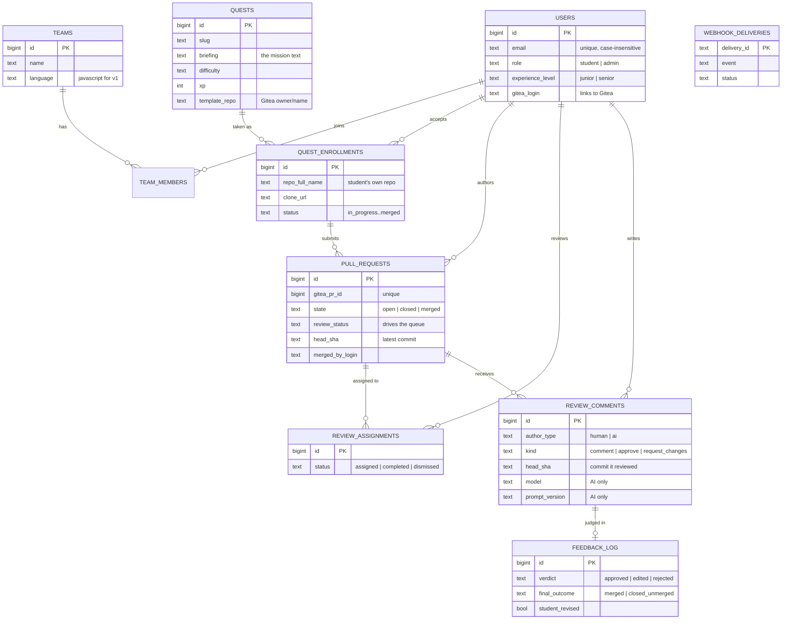
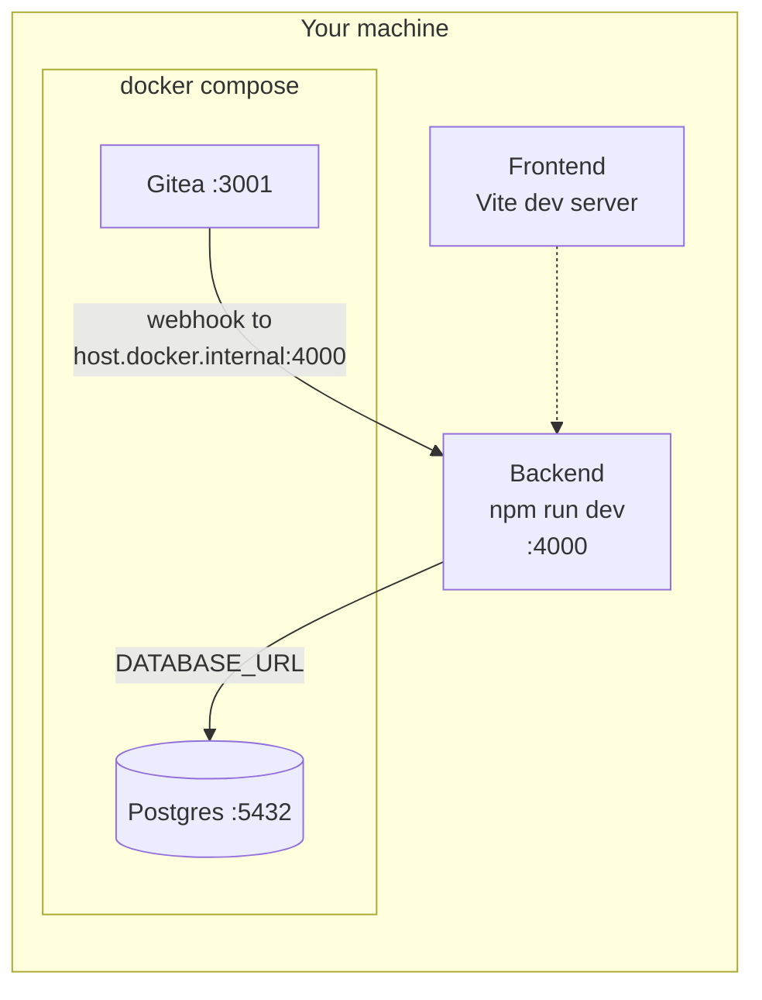
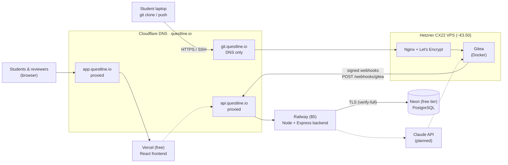
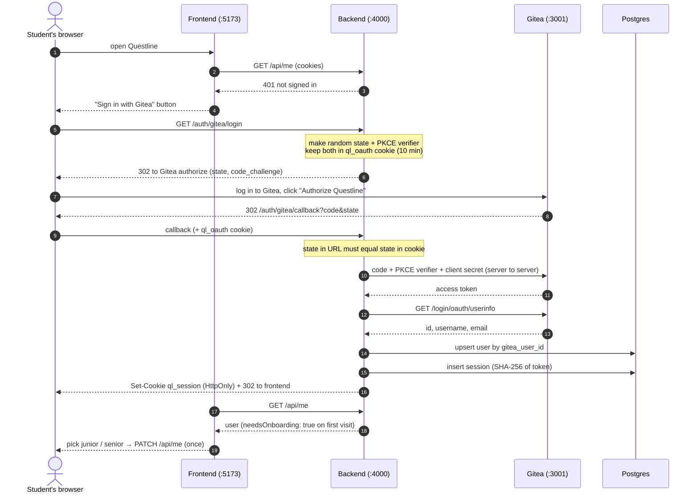

# Questline Architecture

How the pieces of Questline fit together, how a quest flows from "student writes code"
to "quest complete", and why it's built this way. Diagrams are Mermaid: they render on
GitHub, and in VS Code with a Mermaid preview extension.

**Legend used in every diagram:** solid lines and boxes are **built**; dashed lines and
boxes marked *(planned)* are **not built yet**.

---

## 1. The big picture

**In simple words**

- **Gitea is the workshop.** All the code lives there: repos, branches, pull requests and
  reviews. Students never type code into our website; they clone, code and push like real
  developers.
- **Our backend is the scoreboard.** It doesn't store code. It stores *learning progress*:
  who is doing which quest, which PR is waiting for review, who reviewed it, and whether it
  was merged.
- **Webhooks are the phone line between them.** Whenever something happens in Gitea (a PR
  opened, a review submitted, a merge), Gitea calls our backend and we update the scoreboard.
- **The frontend is the window onto the scoreboard** (quest catalogue, clone URL, reviewer
  queue). Sign-in, onboarding and sign-out talk to the real API; quests and stats are still
  sample data until the quest API is built.
- **Gitea is also the ID desk.** Students sign in to Questline with their Gitea account
  ("Sign in with Gitea"), so there's one account and Questline never handles passwords. See §8.
- **The AI reviewer comes later.** It will read each PR's diff and leave an *advisory*
  comment in Gitea. It can't approve or merge anything.

> **Key principle:** Gitea is the source of truth for **code**, Postgres is the source of
> truth for **progress**, and webhooks keep them in sync.

---

## 2. Inside the backend

**What each layer does, and why it's separate**

| Layer | Job | Analogy |
|---|---|---|
| `index.js` | Plugs in the *real* database and starts listening | Turning the key in the car |
| `app.js` | Builds the Express app from whatever dependencies it's given | The car body with an engine socket |
| `giteaRouter.js` | Checks the request is genuine, de-duplicates, opens a transaction, sends back the HTTP status | The security desk at the entrance |
| `verifySignature.js` | Confirms Gitea really sent this, and nobody changed it | Checking the wax seal on a letter |
| `giteaHandlers.js` | Decides *what an event means*: "PR opened → put it in the queue" | The manager deciding what to do |
| `store.js` | The only place SQL lives | The filing clerk |
| `pool.js` | Shares database connections and runs "all or nothing" transactions | A shared pool of phone lines |

**Why `app.js` takes its dependencies as arguments:** tests pass in a fake in-memory store,
so the full HTTP flow (signatures, status codes, every event type) is tested without a
database. Production passes the real Postgres store. Same app, different engine.

---

## 3. What happens when a webhook arrives

Example: a student opens a pull request.

**The three safety ideas in this flow**

1. **Prove who's calling (signature).** Gitea stamps each message using a secret only it and
   we know. A forged or edited message fails the check and is rejected before we even read it.
2. **Never do the same thing twice (delivery id).** Gitea may send the same event again
   (timeouts, retries, someone clicking "Redeliver"). We remember every delivery id, like a
   ticket torn at the door.
3. **All or nothing (transaction).** Updating the PR, the quest status and the delivery
   record happens as one unit. If anything breaks halfway, none of it is saved and we return
   500, so Gitea retries a clean slate.

---

## 4. The life of a quest

Each student's quest attempt (`quest_enrollments.status`) moves through these states,
driven entirely by Gitea events:

A pull request itself has **two separate statuses**, because they answer different questions:

- **`state`** — what Git says: `open`, `closed` or `merged`.
- **`review_status`** — where it is in *our* review process:
  `awaiting_review → in_review → changes_requested / approved`.

Analogy: a parcel has "delivered or not" and, separately, "signed for or not". Squashing
them into one field loses information.

The **reviewer queue** is simply: open PRs, ordered by how long they've waited, filtered by
`review_status`.

---

## 5. The data model

**How to read it**

- **Enrollment is the heart:** one student × one quest = one Gitea repo. PRs from that repo
  are linked back to the quest automatically, by repo name.
- **`review_comments` holds both human and AI reviews**, so later we can compare them
  side by side.
- **`feedback_log` is the AI reviewer's report card.** For every AI comment it stores the
  admin's verdict (explicit) and what actually happened to the PR (automatic). That's the
  dataset used to improve the reviewer.
- **`webhook_deliveries` stands alone.** It exists only to spot duplicate events.

---

## 6. Local development setup

- Gitea runs **inside** Docker but the backend runs **on your machine**. From inside a
  container, `localhost` means the container itself, so Gitea reaches the backend through
  the special hostname `host.docker.internal`.
- Gitea blocks webhooks to private addresses by default (so attackers can't use it to probe
  internal networks). `docker-compose.yml` allows only `host.docker.internal`.

---

## 7. Production (v1 plan, ~$10–15/month)

| Piece | Service | Why this choice |
|---|---|---|
| Frontend | **Vercel** (free) | Static React build, preview URL per branch, auto-deploy from `main` |
| Backend | **Railway** (~$5/mo) | Always-on container, so no cold starts. That matters because Gitea webhooks time out |
| Database | **Neon** (free → $19) | Managed serverless Postgres; dev/prod branches; replaces Aurora (~$43/mo) for v1 |
| Git server | **Hetzner CX22** (~€3.50/mo) | Gitea needs a disk for repos and SSH, which serverless platforms can't provide |
| DNS / domain | **Cloudflare** (~$12/yr) | Free DNS, proxy and TLS for app + api |
| AI reviewer | **Claude API** | Planned, added before release |

**How it fits together, in simple words**

- **Same code, different addresses.** Locally the backend talks to Postgres in Docker and
  Gitea calls `host.docker.internal`. In production the backend talks to Neon and Gitea calls
  `https://api.questline.io/webhooks/gitea`. Only environment variables change.
- **`git.questline.io` must be "DNS only" in Cloudflare.** Cloudflare's proxy only forwards
  web traffic, not SSH on port 22, so proxied SSH `git push` would break. Nginx on the VPS
  handles HTTPS itself with a Let's Encrypt certificate.
- **One webhook URL for everything.** A Gitea *system* webhook sends every repo's PR and
  review events to `/webhooks/gitea`. Merges arrive there as `pull_request` + `closed` +
  `merged: true`, so no separate merge endpoint is needed. Enable both
  **Pull Request** and **Pull Request Review** events; without reviews the reviewer queue can't
  update.
- **Database TLS.** Use `?sslmode=verify-full` in the Neon `DATABASE_URL`. `sslmode` in the URL
  overrides `DATABASE_SSL` / `DATABASE_SSL_CA`. Neon uses a public CA, so no CA file is needed.
  Neon's default `sslmode=require` works today, but `pg` warns it will stop checking the
  certificate in pg v9.
- **Migrations run by hand** (`npm run migrate` with `DATABASE_URL` pointing at Neon), on the
  `dev` branch first, then `main`, before deploying code that needs them.
- **Monorepo.** Vercel's root directory is `frontend/`, Railway's is `backend/`.
  Railway runs `npm start` and sets `PORT` itself.
- **Admin-only merging** is enforced in Gitea with protected branches. The webhook can only
  observe a merge after it happens, and logs a warning if the merger isn't the admin.
- **Sign-in settings on Railway:** `NODE_ENV=production` (turns on `Secure` cookies),
  `FRONTEND_URL=https://app.questline.io`, `GITEA_OAUTH_REDIRECT_URL=https://api.questline.io/auth/gitea/callback`,
  and the production Gitea OAuth app's client id and secret. That OAuth app is separate from the local one,
  because its redirect URI is different. Vercel needs `VITE_API_URL=https://api.questline.io`.

**Upgrade path:** ~500 students → Neon Pro, Hetzner CX32, Gitea backups to S3. Paying users →
AWS (Aurora PostgreSQL, ECS Fargate, ALB, CloudWatch). Because the backend uses plain
`pg` and standard SQL, moving Neon → Aurora is a connection-string change plus a data copy.

---

## 8. Sign in with Gitea

Every student needs a Gitea account anyway (that's where they push and open PRs), so Gitea is
also how they sign in to Questline. Gitea has a built-in OAuth2 / OpenID Connect provider,
the same mechanism as "Sign in with Google".

**The safety pieces, simply explained**

- **`state` (anti-forgery ticket).** Before sending you to Gitea we give your browser a random
  ticket and remember it in a cookie. When Gitea sends you back, the ticket in the URL must match
  the cookie. Otherwise an attacker could send you a link that signs you in to *their* account.
- **PKCE (secret handshake).** We keep a random "verifier" and only show Gitea its fingerprint
  (SHA-256). To turn the one-time code into a token you need the original verifier, so a stolen
  code alone is useless.
- **Server-side sessions, not JWTs.** The cookie holds a random token; the database stores only
  its fingerprint. Logout deletes the row, which ends the session instantly. A JWT stays valid
  until it expires, even after logout.
- **Cookie flags.** `HttpOnly` means page JavaScript can't read the cookie (an XSS bug can't
  steal it). `SameSite=Lax` means other websites can't make your browser send it on their
  forms. `Secure` (production) means HTTPS only.
- **CORS + Origin check.** Only `FRONTEND_URL` may call the API from a browser. Any request
  that changes something must also carry that exact `Origin` header (CSRF protection).
- **Rank is chosen once.** Seniors review other people's code, so a junior can't later promote
  themselves: the second `PATCH /api/me` returns 409. Changing it later is an admin action.
- **Admin role comes from config.** `GITEA_ADMIN_LOGIN` gets `admin` and it's re-checked on every
  sign-in, so changing the setting moves admin rights instead of leaving a stale admin behind.

**Local cookies across ports.** The frontend (`localhost:5173`) and backend (`localhost:4000`) are
different *origins* but the same *site* (ports don't count for cookies), so the session cookie
works locally. In production `app.questline.io` and `api.questline.io` are the same site too.

### Planned: branded Questline sign-up (option 2)

Later, Questline gets its own sign-up page for branding:

1. The student signs up on Questline (username, email, password).
2. The backend creates the matching Gitea account through Gitea's admin API and stores its id
   on the same `users` row (`gitea_user_id`), with our own `password_hash`.
3. Webhooks keep working unchanged, because PRs are still matched by Gitea username.

What's already in place so this is an add-on, not a rewrite: users are keyed by
`gitea_user_id`, `users.password_hash` already exists, sessions don't care how you signed in,
and the frontend only talks to `/api`. Both methods can coexist, so existing students keep
"Sign in with Gitea". The new work: password hashing (argon2/bcrypt), email verification,
password reset, rate limiting on login, and keeping the Questline and Gitea passwords in step.

---

## 9. Built vs planned

| Area | Status |
|---|---|
| Postgres schema + migrations | ✅ Built, applied to local Postgres, smoke-tested with signed webhooks |
| Gitea webhook: signature, dedupe, transactions | ✅ Built + tested |
| PR lifecycle, reviewer statuses, merge outcome logging | ✅ Built + tested |
| Sign in with Gitea, sessions, onboarding (junior/senior), sign-out | ✅ Built + tested (needs a Gitea OAuth app to try) |
| Frontend ↔ backend: API client, CORS, CSRF origin check | ✅ Built + tested |
| Lint, format, automated tests (backend 61, frontend 14) | ✅ |
| Quest catalogue API + per-student repo creation (clone URL) | ⏳ Next |
| Reviewer queue + assignment API | ⏳ Next |
| Branded Questline sign-up (option 2) | 🔜 Planned |
| AI reviewer (Claude): advisory PR comments | 🔜 Before release |
| AI reviewer v2 (RAG) and v3 (eval set from `feedback_log`) | 🔜 After release |
| Java packs, `questline` CLI, AI scrum master | 🔭 Later |
